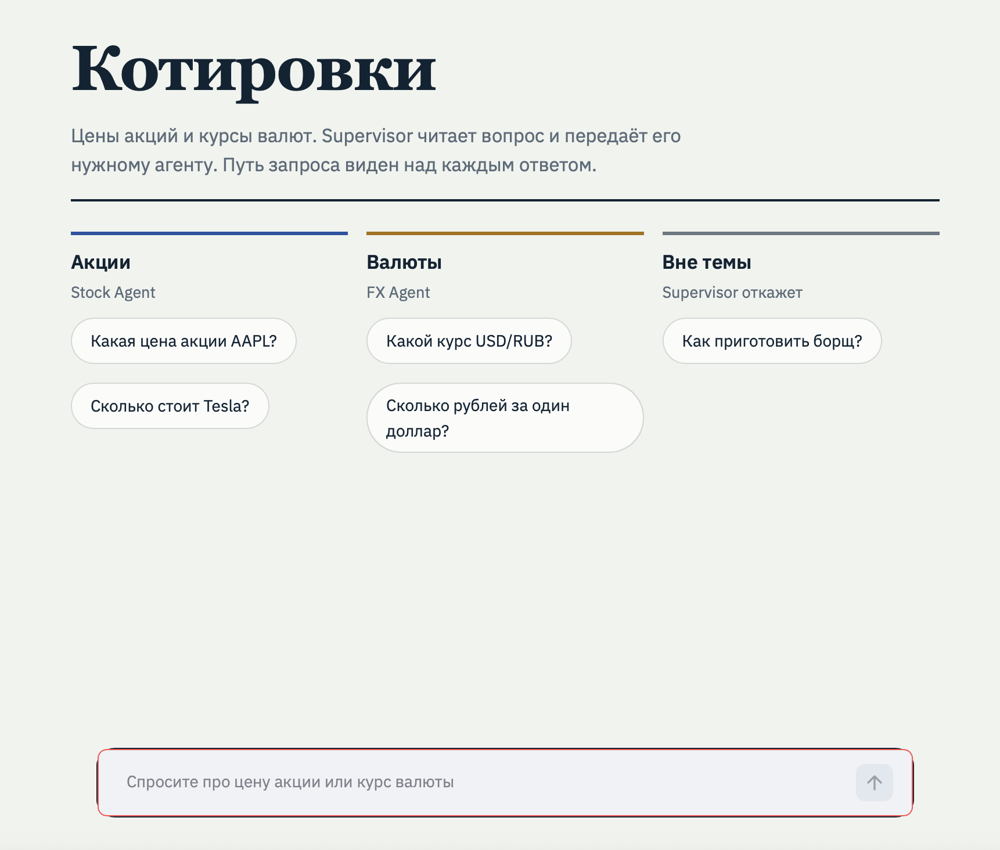

# Котировки — мультиагентная система для акций и валют

Мультиагентная система на LangGraph с паттерном **Supervisor**: оркестратор читает вопрос на естественном языке и передаёт его специализированному агенту — для цен акций (Мосбиржа + США) или курсов валют.



## Что умеет

- **Акции российских компаний** — Газпром, Сбербанк, Лукойл, Норникель (данные Московской биржи через ISS API, без ключа).
- **Акции США** — Apple, Tesla, Google, Microsoft, Nvidia (данные `xfinlink`).
- **Курсы валют** — USD/RUB, EUR/RUB, GBP/USD, USD/EUR и другие (данные ЕЦБ).
- **Понимает естественный язык** — «Сколько стоит Тесла?», «Курс доллара к рублю», «Цена акций Газпрома».
- **Визуализирует маршрут** — над каждым ответом видно, как Supervisor передал запрос агенту.

## Архитектура

```
Пользователь → Supervisor (LLM определяет тип запроса)
                ├── Stock Agent → MOEX (ISS API) или US (xfinlink)
                └── FX Agent    → exrate (данные ЕЦБ)
```

**Supervisor** не отвечает сам — он только маршрутизирует. Если вопрос не про акции и не про валюты, он завершает работу.

**Stock Agent** использует двухступенчатую идентификацию компании:
1. Быстрые правила — словарь алиасов (`Tesla → TSLA`, `Apple → AAPL`).
2. LLM-извлечение — если правила не сработали, LLM выделяет компанию, тикер и биржу из вопроса.

Затем агент пробует найти бумагу на **Мосбирже** (для российских компаний) и на **рынке США** — в зависимости от того, где компания торгуется.

## Стек

| Компонент | Технология |
|-----------|-----------|
| Оркестрация агентов | LangGraph |
| LLM для Supervisor и извлечения компаний | Groq API (`gpt-oss-120b`) |
| Акции США | `xfinlink` |
| Акции РФ | ISS API Московской биржи (без ключа, только стандартная библиотека) |
| Курсы валют | `exrate` (данные Европейского центрального банка) |
| Интерфейс | Streamlit + кастомный CSS |
| Формат данных | Pydantic-совместимые словари, JSON |

## Метрики

Оценка качества маршрутизации Supervisor на наборе из 20 запросов (stock / fx / finish):

- **Accuracy: 1.00** (20/20)
- **F1 по классам:** stock = 1.00, fx = 1.00, finish = 1.00

Запуск оценки:
```bash
python3 eval.py
```

## Структура проекта

```
.
├── agents/                  # специализированные агенты
│   ├── stock_agent.py       # узел Stock Agent
│   └── fx_agent.py          # узел FX Agent
├── supervisor/              # оркестратор
│   ├── prompt.py            # промпт для маршрутизации
│   └── supervisor_node.py   # узел Supervisor + условный переход
├── graph/                   # сборка графа
│   ├── state.py             # AgentState
│   └── build.py             # build_graph()
├── tools/                   # инструменты
│   ├── financial.py         # get_stock_quote, get_fx_rate
│   └── moex.py              # клиент ISS API Мосбиржи
├── config.py                # LLM и API-ключи
├── main.py                  # CLI-режим (интерактивный + демо)
├── app.py                   # Streamlit-интерфейс
└── eval.py                  # оценка маршрутизации
```

## Запуск

### 1. Установка зависимостей

```bash
pip install -r requirements.txt
```

### 2. Переменные окружения

```bash
export GROQ_API_KEY="gsk_..."          # обязательно
export XFINLINK_API_KEY="..."          # для акций США
```

Для акций Московской биржи ключ **не нужен** — используется открытый ISS API.

### 3. Веб-интерфейс (рекомендуется)

```bash
streamlit run app.py
```

Откроется на `http://localhost:8501`.

### 4. CLI-режим

```bash
python3 main.py          # интерактивный режим
python3 main.py --demo   # демо с тремя запросами
```

### 5. Оценка маршрутизации

```bash
python3 eval.py
```

## Примеры запросов

| Запрос | Агент | Что вернёт |
|--------|-------|-----------|
| `Какая цена акции AAPL?` | Stock | Цена Apple с рынка США |
| `Сколько стоит Газпром?` | Stock | Цена GAZP с Мосбиржи |
| `Цена Tesla?` | Stock | Цена TSLA с рынка США |
| `Какой курс USD/RUB?` | FX | Курс доллара к рублю |
| `Сколько рублей за один доллар?` | FX | То же, но на естественном языке |
| `Как приготовить борщ?` | finish | Вежливый отказ |

## Как работает маршрутизация

1. **Пользователь** задаёт вопрос.
2. **Supervisor** отправляет вопрос в LLM с промптом, который просит выбрать `stock`, `fx` или `finish`.
3. В зависимости от решения, управление переходит к **Stock Agent** или **FX Agent** (или граф завершается).
4. Агент вызывает инструмент и возвращает результат.
5. Управление возвращается к Supervisor, который видит `done=True` и завершает работу.

В интерфейсе маршрут визуализируется как цепочка: **Supervisor → агент → ответ**. Пустые кружки — маршрутизация, закрашенные — источник данных.

## Особенности реализации

### Идентификация компании в Stock Agent

Прямой парсинг тикера из вопроса плохо работает для русского языка: «Сколько стоит Тесла?» не содержит тикера `TSLA`. Поэтому используется двухступенчатая схема:

1. **Словарь алиасов** — быстрый путь для популярных компаний (`APPLE → AAPL`, `TESLA → TSLA`, `ГАЗПРОМ → GAZP`).
2. **LLM-извлечение** — если алиас не найден, LLM возвращает JSON с полями `company`, `company_en`, `ticker`, `exchange`.
3. **Fallback без LLM** — если LLM недоступна, из вопроса вырезаются русские слова без падежных окончаний и используются как поисковые запросы к ISS.

### Два рынка в одном агенте

Stock Agent сначала пробует **Мосбиржу** (для российских компаний) или **рынок США** (для зарубежных) — в зависимости от поля `exchange`, которое вернула LLM. Если на одном рынке бумага не найдена, агент пробует второй.

### Отсутствие ключа для MOEX

ISS API Московской биржи **не требует ключа** и работает только на стандартной библиотеке Python (`urllib`, `json`). Это упрощает деплой и избавляет от лишних зависимостей.

## Ограничения

- **Курсы валют** — данные ЕЦБ, обновляются раз в день. Для пар с рублём это означает, что курс может быть менее актуальным, чем биржевой.
- **MOEX** — данные с задержкой 15 минут (стандарт для бесплатного ISS API).
- **xfinlink** — бесплатный тариф ограничен 5000 запросов в день.
- **Supervisor** — использует LLM, поэтому требует `GROQ_API_KEY` и работает через интернет.

## Что можно улучшить

- **Параллельный вызов агентов** — если запрос требует и акций, и валют одновременно («Сравни AAPL и USD/RUB»).
- **Память диалога** — `InMemorySaver` для контекста между запросами («А какая цена у GOOG?» после вопроса про AAPL).
- **Больше агентов** — `News Agent` для новостей о компаниях, `Calculator Agent` для расчётов.
- **Кэширование котировок** — чтобы не дёргать API при повторных запросах.
